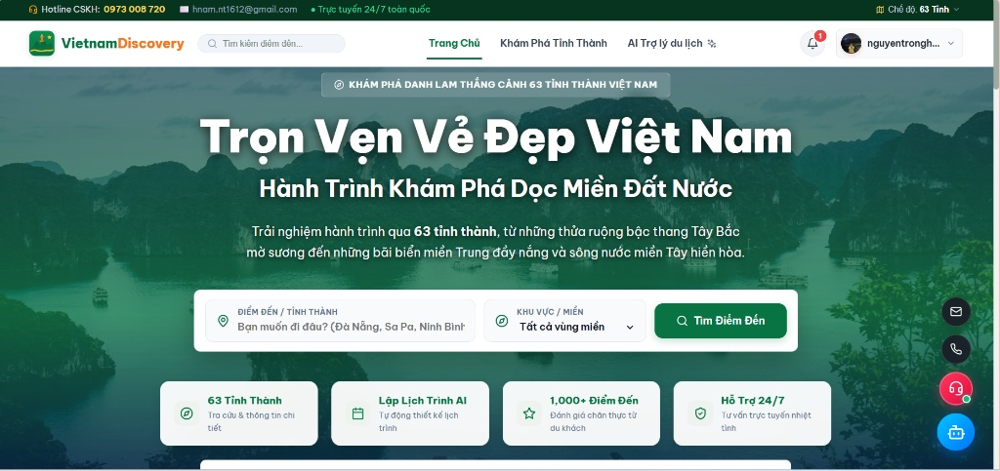

# 🇻🇳 Vietnam Discovery

### Trọn Vẹn Vẻ Đẹp Việt Nam

**Vietnam Discovery** là nền tảng khám phá du lịch Việt Nam, giúp người dùng tìm kiếm địa điểm, khám phá văn hóa, chia sẻ trải nghiệm và xây dựng lịch trình du lịch thông minh trên khắp cả nước.

**Project Developer:** Nguyễn Trọng Hải Nam

---

## 📌 1. Giới thiệu dự án

Vietnam Discovery là nền tảng web du lịch được phát triển theo kiến trúc **Microservices Architecture**, sử dụng Docker Compose để quản lý, xây dựng và triển khai toàn bộ hệ thống.

Nền tảng cung cấp các chức năng tìm kiếm địa điểm du lịch, tra cứu thông tin tỉnh thành, chia sẻ bài viết cộng đồng, đánh giá địa điểm, tương tác trực tuyến và tích hợp trợ lý AI hỗ trợ tư vấn lịch trình.

Đặc biệt, hệ thống hỗ trợ tra cứu dữ liệu hành chính theo hai chế độ **63 tỉnh/thành và 34 tỉnh/thành**, giúp người dùng linh hoạt khám phá dữ liệu địa lý Việt Nam theo các giai đoạn hành chính khác nhau.

### 🎯 Mục tiêu sản phẩm

- Xây dựng cổng thông tin du lịch Việt Nam với giao diện hiện đại, trực quan và responsive.
- Kết nối cộng đồng du lịch thông qua đăng bài, bình luận, đánh giá và tương tác.
- Hỗ trợ tra cứu tỉnh thành, vùng miền và địa điểm du lịch.
- Tích hợp trí tuệ nhân tạo để tư vấn điểm đến và thiết kế lịch trình.
- Xây dựng hệ thống có khả năng mở rộng, bảo trì và triển khai độc lập theo từng Microservice.

---

## 🏛️ 2. Kiến trúc hệ thống

Vietnam Discovery được xây dựng theo mô hình Microservices. Các dịch vụ được đóng gói thành Docker Image và điều phối thông qua Docker Compose.

### 2.1. Công nghệ sử dụng

| Thành phần       | Công nghệ                          | Chức năng                      |
| ---------------- | ---------------------------------- | ------------------------------ |
| Frontend         | React 18, Vite, Lucide Icons       | Giao diện người dùng           |
| API Gateway      | Nginx                              | Reverse Proxy, định tuyến API  |
| Province Service | Node.js, Express, MySQL            | Quản lý tỉnh thành             |
| Location Service | Node.js, Express, MySQL            | Quản lý địa điểm du lịch       |
| Media Service    | Node.js, Express                   | Upload và phân phối hình ảnh   |
| AI Service       | Node.js, Express, Google Gemini AI | Trợ lý du lịch thông minh      |
| User Service     | Node.js, Express, JWT, Bcrypt      | Xác thực và quản lý tài khoản  |
| Database         | MySQL 8.0                          | Lưu trữ dữ liệu hệ thống       |
| Containerization | Docker, Docker Compose             | Đóng gói và triển khai dịch vụ |
| E2E Testing      | Playwright                         | Kiểm thử tự động               |

### 2.2. Danh sách Microservices

| Service          | Cổng nội bộ | Chức năng                |
| ---------------- | ----------: | ------------------------ |
| Frontend         |          80 | Giao diện website        |
| API Gateway      |          80 | Cổng giao tiếp trung tâm |
| Province Service |        3001 | Quản lý tỉnh thành       |
| Location Service |        3002 | Quản lý địa điểm         |
| Media Service    |        3003 | Quản lý hình ảnh         |
| AI Service       |        3004 | Tích hợp AI              |
| User Service     |        3005 | Xác thực người dùng      |
| MySQL            |        3306 | Cơ sở dữ liệu            |

**Cổng truy cập từ máy chủ:**

- `http://localhost:2222`
- `http://localhost:8080`

Hai cổng trên cùng được ánh xạ đến cổng 80 của API Gateway theo cấu hình Docker Compose hiện tại.

---

## ✨ 3. Chức năng chính

### 3.1. Người dùng và xác thực

- Đăng ký tài khoản.
- Đăng nhập và đăng xuất.
- Xác thực bằng JWT.
- Mã hóa mật khẩu bằng Bcrypt.
- Đăng nhập bằng Google OAuth 2.0.
- Xác minh tài khoản thông qua OTP Email.
- Quản lý hồ sơ cá nhân.
- Phân quyền User và Admin.

### 3.2. Khám phá tỉnh thành

- Tra cứu danh sách tỉnh/thành phố Việt Nam.
- Chuyển đổi chế độ dữ liệu 63 tỉnh/thành và 34 tỉnh/thành.
- Hiển thị thông tin địa lý, diện tích, dân số và vùng miền.
- Tra cứu địa điểm theo tỉnh thành.
- Khám phá các khu vực Bắc - Trung - Nam.

### 3.3. Khám phá địa điểm du lịch

- Danh sách địa điểm du lịch.
- Xem thông tin chi tiết địa điểm.
- Hiển thị hình ảnh và nội dung giới thiệu.
- Phân loại địa điểm theo danh mục.
- Tìm kiếm theo từ khóa.
- Lọc theo tỉnh thành và vùng miền.

### 3.4. Cộng đồng du lịch

- Đăng bài chia sẻ địa điểm du lịch.
- Gửi địa điểm mới để quản trị viên xét duyệt.
- Bình luận và phản hồi bình luận.
- Tương tác bằng cảm xúc.
- Theo dõi trạng thái duyệt bài.

### 3.5. Thông báo và hỗ trợ trực tuyến

- Thông báo khi có tương tác mới.
- Thông báo khi bài đăng được duyệt hoặc từ chối.
- Cập nhật thông báo theo thời gian thực.
- Hỗ trợ liên hệ thông qua Chat, Hotline và Email.

### 3.6. AI Travel Assistant

- Tư vấn điểm đến du lịch.
- Gợi ý địa điểm phù hợp.
- Hỗ trợ xây dựng lịch trình du lịch.
- Tư vấn thông tin và trải nghiệm du lịch.
- Tích hợp Google Gemini AI.

### 3.7. Quản trị hệ thống

- Quản lý tài khoản người dùng.
- Quản lý và kiểm duyệt bài đăng.
- Phê duyệt hoặc từ chối địa điểm do người dùng gửi.
- Quản lý nội dung và phản hồi.
- Hỗ trợ người dùng thông qua hệ thống liên hệ.

---

## 📁 4. Cấu trúc thư mục dự án

```text
VietnamDiscovery/
│
├── .github/
│   └── workflows/              # GitHub Actions CI/CD
│
├── api-gateway/                 # Nginx API Gateway
│
├── frontend/                    # React + Vite
│
├── province-service/             # Quản lý tỉnh thành
│
├── location-service/             # Quản lý địa điểm du lịch
│
├── media-service/                # Upload và quản lý hình ảnh
│
├── ai-service/                   # Google Gemini AI
│
├── user-service/                 # Authentication & User Management
│
├── e2e/                          # Playwright E2E Testing
│
├── scripts/                      # Scripts hỗ trợ triển khai
│
├── db/
│   ├── init.sql                  # Khởi tạo database
│   └── backup_xampp.sql          # Dữ liệu sao lưu mẫu
│
├── .env                          # Biến môi trường (không commit)
├── .gitignore                    # Cấu hình Git Ignore
├── docker-compose.yml             # Điều phối Docker Services
└── README.md                     # Tài liệu dự án
```

---

## 🚀 5. Hướng dẫn cài đặt và khởi chạy

### 5.1. Yêu cầu hệ thống

Trước khi cài đặt, cần chuẩn bị:

- Windows 10/11, Linux hoặc macOS.
- Git.
- Docker Desktop hoặc Docker Engine.
- Docker Compose V2.

Kiểm tra môi trường:

```bash
docker --version
docker compose version
git --version
```

### 5.2. Clone repository

```bash
git clone https://github.com/hainam-it/VietnamDiscovery.git

cd VietnamDiscovery
```

### 5.3. Cấu hình biến môi trường

Tạo file `.env` tại thư mục gốc dự án.

File môi trường chứa các thông tin cấu hình cần thiết như:

- MySQL Database.
- JWT Secret.
- Google OAuth Client ID và Client Secret.
- Google Gemini API Key.
- Gmail SMTP phục vụ xác minh OTP.
- Các thông số kết nối giữa những dịch vụ.

**Lưu ý bảo mật:**

File `.env` không được đưa lên GitHub vì có thể chứa thông tin xác thực và khóa API nhạy cảm.

Các giá trị thực tế cần được cấu hình theo môi trường triển khai. Không sử dụng mật khẩu hoặc API key mẫu cho môi trường production.

### 5.4. Build và khởi chạy hệ thống

Tại thư mục gốc dự án, chạy:

```bash
docker compose up -d --build
```

Lệnh trên thực hiện:

1. Build Docker Image cho các dịch vụ.
2. Khởi tạo các container.
3. Thiết lập mạng kết nối giữa các dịch vụ.
4. Khởi động MySQL.
5. Khởi động Frontend, API Gateway và các Microservices.

### 5.5. Kiểm tra trạng thái hệ thống

```bash
docker compose ps
```

Theo dõi log toàn bộ hệ thống:

```bash
docker compose logs -f
```

Theo dõi log của một dịch vụ:

```bash
docker compose logs -f user-service
```

Một số dịch vụ có thể cần thêm thời gian khởi động sau khi container được tạo.

### 5.6. Truy cập ứng dụng

Sau khi hệ thống khởi động thành công, mở trình duyệt:

| Thành phần                  | Địa chỉ                                        |
| --------------------------- | ---------------------------------------------- |
| Vietnam Discovery           | [http://localhost:2222](http://localhost:2222) |
| API Gateway (cổng thay thế) | [http://localhost:8080](http://localhost:8080) |

### 5.7. Dừng và khởi động lại hệ thống

Dừng các container:

```bash
docker compose down
```

Khởi động lại:

```bash
docker compose up -d
```

Build lại khi có thay đổi mã nguồn:

```bash
docker compose up -d --build
```

**Lưu ý:** Không sử dụng `docker compose down -v` nếu chưa có bản sao lưu database, vì tùy cấu hình volume, thao tác này có thể xóa dữ liệu lưu trữ.

---

## 🗄️ 6. Cơ sở dữ liệu

Hệ thống sử dụng **MySQL 8.0** để lưu trữ dữ liệu.

Database được cấu hình với tên:

```text
vietnamdiscovery
```

File khởi tạo:

```text
db/init.sql
```

Khi MySQL khởi chạy lần đầu với volume dữ liệu trống, script khởi tạo database được thực thi tự động theo cấu hình Docker Compose.

Nếu volume đã tồn tại, MySQL sẽ tiếp tục sử dụng dữ liệu hiện có và không tự động chạy lại toàn bộ script khởi tạo.

Các thao tác thay đổi cấu trúc database cần được thực hiện có kiểm soát và sao lưu dữ liệu trước khi triển khai.

---

## 🧪 7. Kiểm thử hệ thống

Dự án tích hợp Playwright để thực hiện kiểm thử End-to-End (E2E).

Thư mục kiểm thử:

```text
e2e/
```

Cài đặt dependencies:

```bash
cd e2e
npm install
```

Cài đặt trình duyệt kiểm thử:

```bash
npx playwright install
```

Chạy toàn bộ bài kiểm thử:

```bash
npx playwright test
```

Chạy kiểm thử với giao diện:

```bash
npx playwright test --ui
```

Xem báo cáo:

```bash
npx playwright show-report
```

---

## 🔐 8. Bảo mật hệ thống

Vietnam Discovery sử dụng các cơ chế bảo mật:

- JWT phục vụ xác thực và quản lý phiên đăng nhập.
- Bcrypt để mã hóa mật khẩu.
- Google OAuth 2.0 hỗ trợ đăng nhập.
- OTP Email hỗ trợ xác minh tài khoản.
- Phân quyền người dùng và quản trị viên.
- Biến môi trường để quản lý thông tin cấu hình nhạy cảm.
- `.gitignore` để loại trừ file cấu hình bí mật và dữ liệu không cần thiết.

**Quan trọng:** Không commit các file chứa mật khẩu, API key, JWT Secret, private key hoặc thông tin xác thực lên repository công khai.

---

## 🖼️ 9. Giao diện hệ thống

Vietnam Discovery được thiết kế theo phong cách hiện đại, lấy cảm hứng từ du lịch và thiên nhiên Việt Nam.


Định hướng nhận diện thương hiệu:

- Màu xanh lá đậm `#166534`.
- Cam đất làm màu nhấn.
- Giao diện sáng, trực quan.
- Thiết kế Responsive trên máy tính, máy tính bảng và điện thoại.
- Hệ thống điều hướng hỗ trợ khám phá tỉnh thành và địa điểm.

Có thể bổ sung ảnh chụp giao diện vào thư mục:

```text
docs/screenshots/
```

Ví dụ:

```markdown

```

---

## 🌐 10. Repository

**GitHub:** [https://github.com/hainam-it/VietnamDiscovery](https://github.com/hainam-it/VietnamDiscovery)

Repository lưu trữ mã nguồn, cấu hình Docker Compose, tài liệu hướng dẫn và các thành phần cần thiết để phát triển hệ thống.

---

## 👨‍💻 11. Tác giả

**Nguyễn Trọng Hải Nam**

Project Developer – Vietnam Discovery

---

\<p align="center">   🇻🇳 \<strong>VIETNAM DISCOVERY\</strong>   \<br/>   \<em>Trọn Vẹn Vẻ Đẹp Việt Nam\</em>   \<br/>\<br/>   Khám phá Việt Nam – Kết nối hành trình – Lan tỏa trải nghiệm. \</p>
